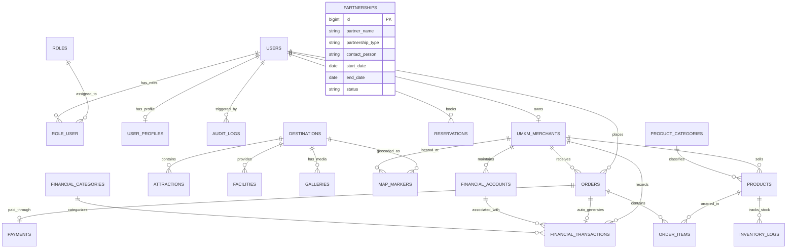

# DATABASE DESIGN & DATA DICTIONARY
## JUMIANG SMART TOURISM & UMKM
**Relational Database Specification for MySQL 8.4 / MariaDB (InnoDB Engine)**

---

## 1. ENTITY RELATIONSHIP DIAGRAM (ERD)

---

## 2. KAMUS DATA & SKEMA TABEL (DATA DICTIONARY)

### 2.1 Modul Autentikasi & Pengguna

#### Tabel: `roles`
Menyimpan daftar peran pengguna dalam sistem.
| Nama Kolom | Tipe Data | Nullable | Default | Keterangan |
|---|---|---|---|---|
| `id` | BIGINT UNSIGNED | NO | AUTO_INC | Primary Key |
| `name` | VARCHAR(50) | NO | - | Nama unik role (`super_admin`, `pengelola_wisata`, `pelaku_umkm`, `bendahara`, `pimpinan`, `wisatawan`) |
| `display_name` | VARCHAR(100) | NO | - | Nama tampilan manusiawi |
| `description` | TEXT | YES | NULL | Deskripsi tugas dan wewenang |
| `created_at` | TIMESTAMP | YES | CURRENT | Waktu dibuat |
| `updated_at` | TIMESTAMP | YES | CURRENT | Waktu diperbarui |

#### Tabel: `users`
Menyimpan kredensial autentikasi pengguna.
| Nama Kolom | Tipe Data | Nullable | Default | Keterangan |
|---|---|---|---|---|
| `id` | BIGINT UNSIGNED | NO | AUTO_INC | Primary Key |
| `name` | VARCHAR(150) | NO | - | Nama lengkap |
| `email` | VARCHAR(191) | NO | - | Email unik untuk login |
| `phone_number` | VARCHAR(30) | YES | NULL | Nomor kontak telepon/WhatsApp |
| `password` | VARCHAR(255) | NO | - | Hash bcrypt password |
| `is_active` | BOOLEAN | NO | 1 | Status aktif (1: Aktif, 0: Dinonaktifkan) |
| `remember_token` | VARCHAR(100) | YES | NULL | Token sesi persistent |
| `created_at` | TIMESTAMP | YES | CURRENT | Waktu pendaftaran |
| `updated_at` | TIMESTAMP | YES | CURRENT | Waktu pembaruan akun |

#### Tabel: `role_user`
Pivot table relasi many-to-many pengguna dengan perannya.
| Nama Kolom | Tipe Data | Nullable | Default | Keterangan |
|---|---|---|---|---|
| `user_id` | BIGINT UNSIGNED | NO | - | Foreign Key -> `users.id` (ON DELETE CASCADE) |
| `role_id` | BIGINT UNSIGNED | NO | - | Foreign Key -> `roles.id` (ON DELETE CASCADE) |

#### Tabel: `user_profiles`
Menyimpan informasi tambahan profil pengguna.
| Nama Kolom | Tipe Data | Nullable | Default | Keterangan |
|---|---|---|---|---|
| `id` | BIGINT UNSIGNED | NO | AUTO_INC | Primary Key |
| `user_id` | BIGINT UNSIGNED | NO | - | Foreign Key unik -> `users.id` (ON DELETE CASCADE) |
| `address` | TEXT | YES | NULL | Alamat tempat tinggal |
| `avatar_url` | VARCHAR(255) | YES | NULL | Path file avatar |
| `bio` | VARCHAR(255) | YES | NULL | Deskripsi singkat |
| `created_at` | TIMESTAMP | YES | CURRENT | Timestamp |
| `updated_at` | TIMESTAMP | YES | CURRENT | Timestamp |

---

### 2.2 Modul Pariwisata & Geospasial (GIS)

#### Tabel: `destinations`
Menyimpan profil destinasi utama Pantai Jumiang.
| Nama Kolom | Tipe Data | Nullable | Default | Keterangan |
|---|---|---|---|---|
| `id` | BIGINT UNSIGNED | NO | AUTO_INC | Primary Key |
| `name` | VARCHAR(150) | NO | - | Nama destinasi (Pantai Jumiang) |
| `slug` | VARCHAR(191) | NO | - | Slug URL ramah SEO |
| `description` | LONGTEXT | NO | - | Deskripsi lengkap dan sejarah daya tarik |
| `village` | VARCHAR(100) | NO | Tanjung | Desa lokasi |
| `district` | VARCHAR(100) | NO | Pademawu | Kecamatan lokasi |
| `regency` | VARCHAR(100) | NO | Pamekasan | Kabupaten lokasi |
| `operating_hours` | VARCHAR(100) | NO | - | Contoh: "06:00 - 18:00 WIB" |
| `ticket_price_demo`| DECIMAL(12,2) | NO | 0.00 | Tarif tiket simulasi (Data Demo) |
| `is_demo_data` | BOOLEAN | NO | 1 | Penanda eksplisit data demo |
| `created_at` | TIMESTAMP | YES | CURRENT | Timestamp |
| `updated_at` | TIMESTAMP | YES | CURRENT | Timestamp |

#### Tabel: `attractions`
Titik spot daya tarik di dalam kawasan Pantai Jumiang.
| Nama Kolom | Tipe Data | Nullable | Default | Keterangan |
|---|---|---|---|---|
| `id` | BIGINT UNSIGNED | NO | AUTO_INC | Primary Key |
| `destination_id` | BIGINT UNSIGNED | NO | - | FK -> `destinations.id` |
| `name` | VARCHAR(150) | NO | - | Nama spot (Tebing Jumiang, Pantai Pasir, Sunset Point, dll) |
| `description` | TEXT | YES | NULL | Penjelasan daya tarik |
| `safety_level` | ENUM | NO | SAFE | Nilai: `SAFE`, `WARNING`, `RESTRICTED` |
| `cover_image` | VARCHAR(255) | YES | NULL | Gambar daya tarik |
| `created_at` | TIMESTAMP | YES | CURRENT | Timestamp |
| `updated_at` | TIMESTAMP | YES | CURRENT | Timestamp |

#### Tabel: `facilities`
Fasilitas penunjang di lokasi wisata.
| Nama Kolom | Tipe Data | Nullable | Default | Keterangan |
|---|---|---|---|---|
| `id` | BIGINT UNSIGNED | NO | AUTO_INC | Primary Key |
| `destination_id` | BIGINT UNSIGNED | NO | - | FK -> `destinations.id` |
| `name` | VARCHAR(150) | NO | - | Contoh: Musholla Nurul Bahari, Gazebo Pantai, Toilet Umum |
| `category` | VARCHAR(50) | NO | - | Kategori: `IBADAH`, `SANITASI`, `ISTIRAHAT`, `PARKIR` |
| `condition` | ENUM | NO | BAIK | Nilai: `BAIK`, `PERBAIKAN`, `RUSAK` |
| `created_at` | TIMESTAMP | YES | CURRENT | Timestamp |
| `updated_at` | TIMESTAMP | YES | CURRENT | Timestamp |

#### Tabel: `map_markers`
Data spasial titik marker koordinat (WGS84) untuk peta Leaflet.js.
| Nama Kolom | Tipe Data | Nullable | Default | Keterangan |
|---|---|---|---|---|
| `id` | BIGINT UNSIGNED | NO | AUTO_INC | Primary Key |
| `category` | ENUM | NO | WISATA | Nilai: `WISATA`, `UMKM`, `FASILITAS`, `HOMESTAY`, `PARKIR` |
| `title` | VARCHAR(150) | NO | - | Label nama penanda |
| `description` | TEXT | YES | NULL | Ringkasan informasi popup |
| `latitude` | DECIMAL(10,8) | NO | - | Koordinat lintang (WGS84, misal: -7.228912) |
| `longitude` | DECIMAL(11,8) | NO | - | Koordinat bujur (WGS84, misal: 113.538120) |
| `icon_type` | VARCHAR(50) | NO | default | Tipe penanda pin visual |
| `related_entity_type` | VARCHAR(50) | YES | NULL | Polimorfik: `App\Models\UmkmMerchant`, `App\Models\Facility`, dll |
| `related_entity_id` | BIGINT UNSIGNED | YES | NULL | ID entitas terkait |
| `is_active` | BOOLEAN | NO | 1 | Status penayangan di peta |
| `created_at` | TIMESTAMP | YES | CURRENT | Timestamp |
| `updated_at` | TIMESTAMP | YES | CURRENT | Timestamp |

---

### 2.3 Modul UMKM, Produk, dan Inventori

#### Tabel: `umkm_merchants`
Profil gerai UMKM yang terdaftar di kawasan wisata.
| Nama Kolom | Tipe Data | Nullable | Default | Keterangan |
|---|---|---|---|---|
| `id` | BIGINT UNSIGNED | NO | AUTO_INC | Primary Key |
| `user_id` | BIGINT UNSIGNED | NO | - | FK -> `users.id` (pemilik usaha) |
| `business_name` | VARCHAR(150) | NO | - | Nama dagang UMKM |
| `owner_name` | VARCHAR(150) | NO | - | Nama lengkap pemilik |
| `category` | VARCHAR(50) | NO | KULINER | Kategori usaha: `KULINER`, `KERAJINAN`, `BATIK`, `JASA`, `HOMESTAY` |
| `address` | TEXT | NO | - | Alamat fisik gerai |
| `phone_number` | VARCHAR(30) | NO | - | Nomor kontak WhatsApp usaha |
| `logo_path` | VARCHAR(255) | YES | NULL | Logo usaha |
| `banner_path` | VARCHAR(255) | YES | NULL | Banner gerai |
| `verification_status` | ENUM | NO | PENDING | Nilai: `PENDING`, `VERIFIED`, `REJECTED`, `SUSPENDED` |
| `rejection_reason` | TEXT | YES | NULL | Alasan penolakan jika verifikasi gagal |
| `created_at` | TIMESTAMP | YES | CURRENT | Timestamp |
| `updated_at` | TIMESTAMP | YES | CURRENT | Timestamp |

#### Tabel: `product_categories`
Kategori produk UMKM.
| Nama Kolom | Tipe Data | Nullable | Default | Keterangan |
|---|---|---|---|---|
| `id` | BIGINT UNSIGNED | NO | AUTO_INC | Primary Key |
| `name` | VARCHAR(100) | NO | - | Nama kategori |
| `slug` | VARCHAR(120) | NO | - | Slug URL |
| `icon` | VARCHAR(50) | YES | NULL | Ikon kategori |
| `created_at` | TIMESTAMP | YES | CURRENT | Timestamp |
| `updated_at` | TIMESTAMP | YES | CURRENT | Timestamp |

#### Tabel: `products`
Katalog barang atau jasa yang dijual UMKM.
| Nama Kolom | Tipe Data | Nullable | Default | Keterangan |
|---|---|---|---|---|
| `id` | BIGINT UNSIGNED | NO | AUTO_INC | Primary Key |
| `umkm_merchant_id` | BIGINT UNSIGNED | NO | - | FK -> `umkm_merchants.id` (ON DELETE CASCADE) |
| `category_id` | BIGINT UNSIGNED | NO | - | FK -> `product_categories.id` |
| `name` | VARCHAR(150) | NO | - | Nama produk |
| `slug` | VARCHAR(191) | NO | - | Slug URL |
| `description` | TEXT | YES | NULL | Rincian deskripsi produk |
| `price` | DECIMAL(12,2) | NO | - | Harga satuan (IDR) |
| `stock` | INT | NO | 0 | Jumlah stok tersedia |
| `low_stock_threshold`| INT | NO | 5 | Batas peringatan stok menipis |
| `unit` | VARCHAR(30) | NO | pcs | Satuan: `pcs`, `bungkus`, `kg`, `porsi`, `paket` |
| `image_path` | VARCHAR(255) | YES | NULL | Foto utama produk |
| `is_active` | BOOLEAN | NO | 1 | Status aktif katalog (1: Aktif, 0: Disembunyikan) |
| `created_at` | TIMESTAMP | YES | CURRENT | Timestamp |
| `updated_at` | TIMESTAMP | YES | CURRENT | Timestamp |

#### Tabel: `inventory_logs`
Catatan mutasi stok barang masuk, keluar, dan penyesuaian.
| Nama Kolom | Tipe Data | Nullable | Default | Keterangan |
|---|---|---|---|---|
| `id` | BIGINT UNSIGNED | NO | AUTO_INC | Primary Key |
| `product_id` | BIGINT UNSIGNED | NO | - | FK -> `products.id` (ON DELETE CASCADE) |
| `type` | ENUM | NO | - | Nilai: `IN` (Masuk), `OUT` (Keluar), `ADJUSTMENT` (Penyesuaian) |
| `quantity` | INT | NO | - | Kuantitas perubahan (+ / -) |
| `previous_stock` | INT | NO | - | Stok sebelum perubahan |
| `current_stock` | INT | NO | - | Stok setelah perubahan |
| `reference_type` | VARCHAR(50) | YES | NULL | Contoh: `ORDER_PURCHASE`, `MANUAL_RESTOCK`, `DAMAGE` |
| `reference_id` | BIGINT UNSIGNED | YES | NULL | ID pesanan atau dokumen pendukung |
| `notes` | VARCHAR(255) | YES | NULL | Catatan alasan mutasi |
| `created_by` | BIGINT UNSIGNED | NO | - | FK -> `users.id` |
| `created_at` | TIMESTAMP | YES | CURRENT | Waktu kejadian |

---

### 2.4 Modul Marketplace & Simulasi Pembayaran

#### Tabel: `orders`
Transaksi pesanan belanja wisatawan.
| Nama Kolom | Tipe Data | Nullable | Default | Keterangan |
|---|---|---|---|---|
| `id` | BIGINT UNSIGNED | NO | AUTO_INC | Primary Key |
| `invoice_no` | VARCHAR(50) | NO | - | Nomor faktur unik (contoh: `INV-JMI-20261102-0001`) |
| `user_id` | BIGINT UNSIGNED | NO | - | FK -> `users.id` (Wisatawan pemesan) |
| `umkm_merchant_id` | BIGINT UNSIGNED | NO | - | FK -> `umkm_merchants.id` |
| `total_amount` | DECIMAL(12,2) | NO | - | Total nilai belanja |
| `status` | ENUM | NO | PENDING | Nilai: `PENDING`, `PAID`, `PROCESSING`, `READY_FOR_PICKUP`, `COMPLETED`, `CANCELLED` |
| `delivery_option` | ENUM | NO | PICKUP | Nilai: `PICKUP` (Ambil di Gerai), `DELIVERY` (Antar ke Spot/Homestay) |
| `delivery_notes` | TEXT | YES | NULL | Keterangan lokasi pengantaran / meja |
| `notes` | TEXT | YES | NULL | Catatan pesanan khusus |
| `created_at` | TIMESTAMP | YES | CURRENT | Waktu pemesanan |
| `updated_at` | TIMESTAMP | YES | CURRENT | Waktu update status |

#### Tabel: `order_items`
Rincian item produk dalam sebuah pesanan.
| Nama Kolom | Tipe Data | Nullable | Default | Keterangan |
|---|---|---|---|---|
| `id` | BIGINT UNSIGNED | NO | AUTO_INC | Primary Key |
| `order_id` | BIGINT UNSIGNED | NO | - | FK -> `orders.id` (ON DELETE CASCADE) |
| `product_id` | BIGINT UNSIGNED | NO | - | FK -> `products.id` |
| `price_at_purchase`| DECIMAL(12,2)| NO | - | Harga satuan saat transaksi terjadi |
| `quantity` | INT | NO | - | Jumlah barang dibeli |
| `subtotal` | DECIMAL(12,2) | NO | - | `price_at_purchase` * `quantity` |
| `created_at` | TIMESTAMP | YES | CURRENT | Timestamp |

#### Tabel: `payments`
Pencatatan simulasi transaksi pembayaran digital.
| Nama Kolom | Tipe Data | Nullable | Default | Keterangan |
|---|---|---|---|---|
| `id` | BIGINT UNSIGNED | NO | AUTO_INC | Primary Key |
| `order_id` | BIGINT UNSIGNED | NO | - | FK unik -> `orders.id` (ON DELETE CASCADE) |
| `payment_method` | ENUM | NO | SIMULATION_QRIS | Nilai: `SIMULATION_QRIS`, `SIMULATION_VA`, `CASH_ON_LOCATION` |
| `payment_status` | ENUM | NO | UNPAID | Nilai: `UNPAID`, `PAID`, `EXPIRED`, `REFUNDED` |
| `simulation_ref_no`| VARCHAR(100) | NO | - | Kode referensi unik simulasi transaksi |
| `paid_at` | TIMESTAMP | YES | NULL | Waktu simulasi pembayaran berhasil |
| `is_demo_gateway` | BOOLEAN | NO | 1 | Penanda bahwa ini gateway simulasi akademik |
| `created_at` | TIMESTAMP | YES | CURRENT | Timestamp |
| `updated_at` | TIMESTAMP | YES | CURRENT | Timestamp |

---

### 2.5 Modul Manajemen Keuangan UMKM (Dedicated Bookkeeping)

#### Tabel: `financial_accounts`
Rekening kas terpisah milik UMKM (Pemisahan rekening pribadi vs usaha).
| Nama Kolom | Tipe Data | Nullable | Default | Keterangan |
|---|---|---|---|---|
| `id` | BIGINT UNSIGNED | NO | AUTO_INC | Primary Key |
| `umkm_merchant_id` | BIGINT UNSIGNED | NO | - | FK -> `umkm_merchants.id` (ON DELETE CASCADE) |
| `account_name` | VARCHAR(100) | NO | - | Contoh: "Kas Usaha Gerai Jumiang", "Rekening Tabungan Pribadi" |
| `account_type` | ENUM | NO | BUSINESS | Nilai: `BUSINESS` (Kas Usaha), `PERSONAL` (Kas Pribadi) |
| `initial_balance` | DECIMAL(14,2) | NO | 0.00 | Saldo awal pembukuan |
| `current_balance` | DECIMAL(14,2) | NO | 0.00 | Saldo berjalan terkini |
| `created_at` | TIMESTAMP | YES | CURRENT | Timestamp |
| `updated_at` | TIMESTAMP | YES | CURRENT | Timestamp |

#### Tabel: `financial_categories`
Kategori arus kas masuk dan kas keluar.
| Nama Kolom | Tipe Data | Nullable | Default | Keterangan |
|---|---|---|---|---|
| `id` | BIGINT UNSIGNED | NO | AUTO_INC | Primary Key |
| `name` | VARCHAR(100) | NO | - | Contoh: Penjualan Online, Penjualan Offline, Pembelian Ikan/Bahan, Sewa Tempat, Listrik |
| `type` | ENUM | NO | - | Nilai: `INCOME` (Pemasukan), `EXPENSE` (Pengeluaran) |
| `is_system_default`| BOOLEAN | NO | 0 | 1 jika kategori bawaan sistem |
| `created_at` | TIMESTAMP | YES | CURRENT | Timestamp |
| `updated_at` | TIMESTAMP | YES | CURRENT | Timestamp |

#### Tabel: `financial_transactions`
Jurnal buku kas harian UMKM.
| Nama Kolom | Tipe Data | Nullable | Default | Keterangan |
|---|---|---|---|---|
| `id` | BIGINT UNSIGNED | NO | AUTO_INC | Primary Key |
| `umkm_merchant_id` | BIGINT UNSIGNED | NO | - | FK -> `umkm_merchants.id` (ON DELETE CASCADE) |
| `financial_account_id`| BIGINT UNSIGNED| NO | - | FK -> `financial_accounts.id` |
| `category_id` | BIGINT UNSIGNED | NO | - | FK -> `financial_categories.id` |
| `order_id` | BIGINT UNSIGNED | YES | NULL | FK -> `orders.id` (otomatis jika dari marketplace) |
| `transaction_type` | ENUM | NO | - | Nilai: `INCOME`, `EXPENSE` |
| `amount` | DECIMAL(14,2) | NO | - | Nominal transaksi (IDR) |
| `transaction_date` | DATE | NO | - | Tanggal kejadian transaksi |
| `description` | TEXT | NO | - | Keterangan mutasi |
| `receipt_image` | VARCHAR(255) | YES | NULL | Bukti struk/nota nota pembayaran |
| `created_by` | BIGINT UNSIGNED | NO | - | FK -> `users.id` |
| `created_at` | TIMESTAMP | YES | CURRENT | Timestamp |
| `updated_at` | TIMESTAMP | YES | CURRENT | Timestamp |

---

### 2.6 Modul Reservasi & Kemitraan

#### Tabel: `reservations`
Pemesanan tiket masuk / paket wisata rombongan.
| Nama Kolom | Tipe Data | Nullable | Default | Keterangan |
|---|---|---|---|---|
| `id` | BIGINT UNSIGNED | NO | AUTO_INC | Primary Key |
| `booking_code` | VARCHAR(50) | NO | - | Kode unik booking (contoh: `RSV-JMI-20261102-001`) |
| `user_id` | BIGINT UNSIGNED | NO | - | FK -> `users.id` |
| `destination_id` | BIGINT UNSIGNED | NO | - | FK -> `destinations.id` |
| `visit_date` | DATE | NO | - | Tanggal rencana kunjungan |
| `visitor_count` | INT | NO | 1 | Jumlah orang dalam rombongan |
| `package_name` | VARCHAR(100) | NO | Tiket Masuk Standar | Paket wisata |
| `total_price` | DECIMAL(12,2) | NO | - | Total biaya tiket/paket |
| `status` | ENUM | NO | PENDING | Nilai: `PENDING`, `CONFIRMED`, `ATTENDED`, `CANCELLED` |
| `check_in_time` | TIMESTAMP | YES | NULL | Waktu kedatangan divalidasi pengelola |
| `created_at` | TIMESTAMP | YES | CURRENT | Timestamp |
| `updated_at` | TIMESTAMP | YES | CURRENT | Timestamp |

#### Tabel: `partnerships`
Basis data kemitraan dan perjanjian kerja sama.
| Nama Kolom | Tipe Data | Nullable | Default | Keterangan |
|---|---|---|---|---|
| `id` | BIGINT UNSIGNED | NO | AUTO_INC | Primary Key |
| `partner_name` | VARCHAR(150) | NO | - | Nama institusi/lembaga mitra |
| `partnership_type`| VARCHAR(100) | NO | - | Tipe: `AKADEMISI`, `PEMERINTAH`, `KOMUNITAS`, `SPONSOR` |
| `contact_person` | VARCHAR(100) | NO | - | Narahubung mitra |
| `phone_number` | VARCHAR(30) | YES | NULL | Nomor kontak |
| `start_date` | DATE | NO | - | Tanggal mulai kerja sama |
| `end_date` | DATE | YES | NULL | Tanggal akhir kerja sama |
| `status` | ENUM | NO | ACTIVE | Nilai: `ACTIVE`, `PENDING`, `EXPIRED`, `TERMINATED` |
| `document_url` | VARCHAR(255) | YES | NULL | File dokumen MoU kerja sama |
| `notes` | TEXT | YES | NULL | Ruang lingkup kerja sama |
| `created_at` | TIMESTAMP | YES | CURRENT | Timestamp |
| `updated_at` | TIMESTAMP | YES | CURRENT | Timestamp |

---

### 2.7 Modul Audit Trail & Log Sistem

#### Tabel: `audit_logs`
Catatan aktivitas krusial pengguna untuk akuntabilitas dan forensik sistem.
| Nama Kolom | Tipe Data | Nullable | Default | Keterangan |
|---|---|---|---|---|
| `id` | BIGINT UNSIGNED | NO | AUTO_INC | Primary Key |
| `user_id` | BIGINT UNSIGNED | YES | NULL | FK -> `users.id` (Nullable untuk aksi guest) |
| `action` | VARCHAR(100) | NO | - | Contoh: `USER_LOGIN`, `ORDER_CREATED`, `PRICE_UPDATED`, `STOCK_ADJUSTED` |
| `entity_type` | VARCHAR(100) | YES | NULL | Nama Model terkait (`Product`, `Order`, `UmkmMerchant`, dll) |
| `entity_id` | BIGINT UNSIGNED | YES | NULL | ID record yang diubah |
| `old_values` | JSON | YES | NULL | Nilai sebelum perubahan (format JSON) |
| `new_values` | JSON | YES | NULL | Nilai sesudah perubahan (format JSON) |
| `ip_address` | VARCHAR(45) | YES | NULL | Alamat IP pemanggil |
| `user_agent` | TEXT | YES | NULL | Informasi browser / peranti |
| `created_at` | TIMESTAMP | YES | CURRENT | Waktu kejadian mutasi |

---

## 3. INDEKS & STRATEGI OPTIMASI BASIS DATA

Untuk menjaga waktu respons di bawah 2 detik (NFR-01), indeks khusus diterapkan pada:
1. **Foreign Key Indexes:** Seluruh kolom `*_id` diindeks otomatis.
2. **Composite Indexes:**
   - `orders (umkm_merchant_id, status, created_at)`: Mempercepat kueri laporan penjualan UMKM.
   - `financial_transactions (umkm_merchant_id, transaction_date)`: Mempercepat filter buku kas berkala.
   - `map_markers (category, is_active)`: Mempercepat penarikan data marker Leaflet GIS.
   - `inventory_logs (product_id, created_at)`: Mempercepat pelacakan riwayat stok.
3. **Data Integrity & Isolation:**
   - Seluruh transaksi kas UMKM diverifikasi terhadap `umkm_merchant_id` yang sesuai pada session pengguna untuk mencegah kebocoran data antar pedagang (*Cross-Tenant Data Leakage*).
