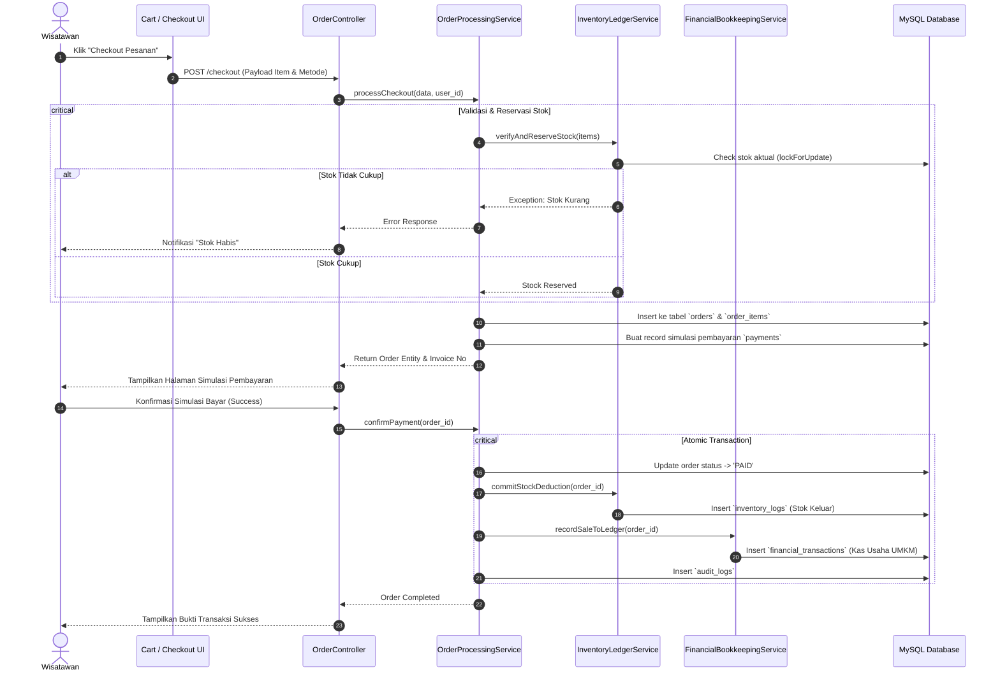
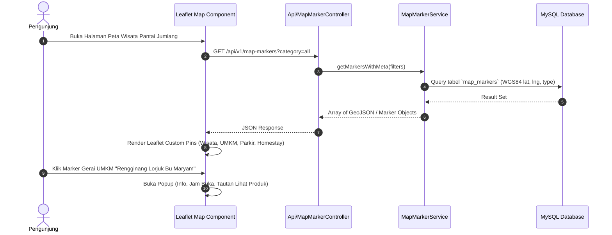

# SYSTEM ARCHITECTURE DOCUMENT
## JUMIANG SMART TOURISM & UMKM
**Modular Monolith Architecture with Service-Layer MVC Pattern**

---

## 1. PENDEKATAN ARSITEKTUR: MODULAR MONOLITH

Sistem **JUMIANG SMART TOURISM & UMKM** dirancang menggunakan pendekatan **Modular Monolith** berbasis framework **Laravel**. 

### 1.1 Mengapa Modular Monolith?
1. **Kesederhanaan Operasional:** Seluruh modul berada dalam satu basis kode (*single codebase*) dan satu basis data (*single database*), menghindari kompleksitas orkestrasi jaringan mikroservis (seperti latency jaringan, distributed transaction, dan overhead infrastruktur) yang tidak relevan untuk skala proyek ini.
2. **Keterpisahan Tanggung Jawab (*Separation of Concerns*):** Modul-modul bisnis (Wisata, UMKM, Marketplace, Keuangan, Inventori, EIS) dipisahkan secara logis ke dalam domain layanan masing-masing melalui **Service Layer Pattern**.
3. **Kemudahan Pengujian Akademik:** Memfasilitasi pelaksanaan pengujian komprehensif (Unit Test, Integration Test, Whitebox Cyclomatic Complexity, dan API Testing) dalam satu lingkungan terpadu sesuai standar RPS MANPRO.
4. **Jalur Evolusi Jelas:** Jika di masa depan modul Marketplace atau GIS ingin dipecah menjadi layanan independen, isolasi antarmuka pada Service Layer memungkinkan refaktorisasi tanpa merombak logika bisnis.

---

## 2. DIAGRAM ARSITEKTUR TINGKAT TINGGI (HIGH-LEVEL ARCHITECTURE)

```mermaid
graph TD
    subgraph ClientLayer["1. Client / Presentation Layer"]
        PublicWeb["Public Portal (Wisatawan)<br>Blade + Bootstrap 5.3 + Alpine.js"]
        AdminDashboard["Admin & Merchant Panel<br>Sidebar Navigation + Chart.js"]
        GISMap["Interactive Web-GIS<br>Leaflet.js + OpenStreetMap Tiles"]
        MobileClient["Mobile Browser / Responsive View"]
    end

    subgraph SecurityRouting["2. Routing & Security Layer"]
        WebRoutes["routes/web.php (Session Auth)"]
        ApiRoutes["routes/api.php (Sanctum/Stateless Token)"]
        RbacMiddleware["RBAC Middleware (Role & Permission Guard)"]
        CsrfRateLimit["CSRF Protection & Rate Limiting"]
    end

    subgraph ApplicationLayer["3. Application / Controller Layer"]
        WebControllers["Web Controllers<br>(Thin Controllers)"]
        ApiControllers["REST API Controllers<br>(JSON Response)"]
        FormRequests["Form Request Validators<br>(Input Sanitization & Rules)"]
    end

    subgraph DomainServiceLayer["4. Domain / Business Service Layer"]
        AuthService["AuthService & UserProfile"]
        TourismService["TourismService & Attractions"]
        MapService["MapMarkerService (GIS Engine)"]
        UmkmService["UmkmMerchantService"]
        ProductService["ProductCatalogService"]
        OrderService["OrderProcessingService"]
        InventoryService["InventoryLedgerService"]
        FinancialService["FinancialBookkeepingService"]
        ReservationService["ReservationService"]
        PartnershipService["PartnershipService"]
        EisService["ExecutiveAnalyticsService"]
        ReportService["ReportingExportService"]
        AuditService["AuditTrailService"]
    end

    subgraph DataAccessLayer["5. Data Access & Persistence Layer"]
        EloquentModels["Eloquent Models & Relations"]
        ApiResources["API Resources / Transformers"]
        Database["MySQL 8.4 Database Engine<br>(InnoDB, Foreign Keys, Indexes)"]
        StorageEngine["Local / S3 Storage (Images & Docs)"]
    end

    ClientLayer --> SecurityRouting
    SecurityRouting --> ApplicationLayer
    ApplicationLayer --> DomainServiceLayer
    DomainServiceLayer --> DataAccessLayer
```



---

## 3. LAPISAN ARSITEKTUR SISTEM (LAYERED STRUCTURE)

### 3.1 Presentation Layer (Antarmuka Pengguna)
- **Engine:** Laravel Blade Template Engine.
- **Styling:** Bootstrap 5.3 dengan pendekatan kustom bertema wisata bahari (*Ocean Blue palette, crisp whites, modern cards, and responsive tables*).
- **Interaktivitas Ringan:** Alpine.js untuk manipulasi DOM reaktif tanpa overhead framework berat (seperti dropdown dinamis, kalkulator kuantitas belanja, modal konfirmasi, dan live search filtering).
- **Pemetaan:** Leaflet.js yang terhubung dengan tile server OpenStreetMap untuk memuat koordinat spasial tanpa ketergantungan API berbayar.
- **Visualisasi Data:** Chart.js untuk menyajikan grafik garis tren transaksi, grafik batang pendapatan UMKM, dan grafik donat proporsi kategori usaha.

### 3.2 Security & Routing Layer
- Menggunakan middleware Laravel untuk menyaring setiap request HTTP:
  - `auth`: Memastikan pengguna telah terotentikasi.
  - `role:{role_name}`: Memeriksa hak akses berbasis role (Super Admin, Pengelola, UMKM, Bendahara, Pimpinan, Wisatawan).
  - `throttle:api`: Melindungi endpoint dari serangan *Brute Force* dan *Denial of Service*.
  - `VerifyCsrfToken`: Memvalidasi token CSRF pada seluruh permintaan mutasi data (POST, PUT, DELETE).

### 3.3 Application / Controller Layer (Thin Controllers)
Prinsip utama: **Controller tidak boleh menampung logika bisnis yang rumit.**
- Menerima HTTP Request.
- Mendelegasikan validasi data kepada **Form Request Class**.
- Memanggil metode yang sesuai pada **Service Class**.
- Mengembalikan HTTP Response (View Blade untuk web browser, atau JSON API Resource untuk permintaan REST API).

### 3.4 Domain / Service Layer (Thick Services)
Seluruh aturan bisnis (*business rules*) dienkapsulasi di sini:
- `OrderProcessingService`: Menangani alur pembuatan invoice, verifikasi kupon/diskon, koordinasi mutasi inventori, serta pencatatan jurnal keuangan otomatis.
- `InventoryLedgerService`: Mengatur atomisitas stok (pengurangan stok, rollback stok pesanan batal, audit saldo fisik).
- `FinancialBookkeepingService`: Menjamin pemisahan buku kas pribadi vs usaha, validasi saldo, dan kalkulasi rugi-laba.
- `ExecutiveAnalyticsService`: Melakukan kalkulasi agregasi metrik makro berbasis kueri SQL berkinerja tinggi.

### 3.5 Persistence Layer (Eloquent ORM & MySQL 8.4)
- Menggunakan engine InnoDB untuk mendukung integritas referensial (Foreign Keys) dan transaksi ACID (`DB::transaction`).
- Seluruh struktur tabel dikelola melalui **Laravel Database Migrations**.
- Pengisian data awal menggunakan **Seeders** dan **Factories** dengan label `[DATA DEMO]`.

---

## 4. DIAGRAM ALUR INTEGRASI BISNIS (SEQUENCE DIAGRAMS)

### 4.1 Alur Transaksi Marketplace, Pengurangan Stok, dan Pencatatan Jurnal Keuangan



---

### 4.2 Alur Pemetaan Spasial (Web-GIS Leaflet & OSM)



---

## 5. STRUKTUR FOLDER MODULAR MONOLITH (LARAVEL DIRECTORY STRUCTURE)

Struktur direktori dirancang rapi untuk memisahkan domain logika bisnis:

```text
app/
├── Http/
│   ├── Controllers/
│   │   ├── Auth/
│   │   │   ├── LoginController.php
│   │   │   ├── RegisterController.php
│   │   │   └── ResetPasswordController.php
│   │   ├── Web/
│   │   │   ├── PublicController.php         # Beranda, Profil Pantai, Peta Publik
│   │   │   ├── DashboardController.php      # Panel Utama Multi-role
│   │   │   ├── TourismController.php        # Kelola Atraksi & Fasilitas
│   │   │   ├── UmkmController.php           # Kelola Merchant & Gerai
│   │   │   ├── ProductController.php        # Katalog & Stok Produk
│   │   │   ├── MarketplaceController.php    # Toko, Cart, Checkout
│   │   │   ├── FinancialController.php      # Pembukuan Kas UMKM
│   │   │   ├── ReservationController.php    # Pemesanan Wisata
│   │   │   ├── PartnershipController.php    # Kemitraan
│   │   │   ├── EisController.php            # Dashboard Eksekutif
│   │   │   ├── ReportController.php         # Ekspor Laporan
│   │   │   └── AuditController.php          # Audit Trail
│   │   └── Api/
│   │       ├── ApiMapMarkerController.php   # Endpoint GIS Markers
│   │       ├── ApiProductController.php     # Endpoint Katalog Produk
│   │       ├── ApiOrderController.php       # Endpoint Pemesanan
│   │       └── ApiTourismController.php     # Endpoint Destinasi
│   ├── Middleware/
│   │   ├── RoleMiddleware.php               # Pengecekan RBAC
│   │   └── AuditActivityMiddleware.php      # Pencatatan Log Aktivitas
│   ├── Requests/                            # Form Request Validation
│   │   ├── Auth/
│   │   ├── Tourism/
│   │   ├── Umkm/
│   │   ├── Product/
│   │   ├── Order/
│   │   ├── Financial/
│   │   └── Reservation/
│   └── Resources/                           # API Resource Transformers
│       ├── MapMarkerResource.php
│       ├── ProductResource.php
│       └── OrderResource.php
│
├── Models/                                  # Eloquent Models
│   ├── User.php
│   ├── Role.php
│   ├── UserProfile.php
│   ├── Destination.php
│   ├── Attraction.php
│   ├── Facility.php
│   ├── MapMarker.php
│   ├── UmkmMerchant.php
│   ├── ProductCategory.php
│   ├── Product.php
│   ├── InventoryLog.php
│   ├── Order.php
│   ├── OrderItem.php
│   ├── Payment.php
│   ├── FinancialAccount.php
│   ├── FinancialCategory.php
│   ├── FinancialTransaction.php
│   ├── Reservation.php
│   ├── Partnership.php
│   └── AuditLog.php
│
└── Services/                                # Business Logic Services
    ├── AuthService.php
    ├── TourismService.php
    ├── MapMarkerService.php
    ├── UmkmService.php
    ├── ProductService.php
    ├── OrderProcessingService.php
    ├── InventoryLedgerService.php
    ├── FinancialBookkeepingService.php
    ├── ReservationService.php
    ├── PartnershipService.php
    ├── ExecutiveAnalyticsService.php
    ├── ReportExportService.php
    └── AuditTrailService.php
```

---

## 6. PRINSIP INTEGRITAS DATA & ISOLASI MULTI-TENANT RINGAN
Untuk Modul Manajemen Keuangan UMKM (`MOD-FIN`):
- Digunakan pola isolasi *Merchant-Scoped Querying*:
  ```php
  // Contoh implementasi pada FinancialTransaction Model Scope
  public function scopeForMerchant($query, $merchantId) {
      return $query->where('umkm_merchant_id', $merchantId);
  }
  ```
- Pelaku UMKM hanya dapat membaca dan menulis data transaksi finansial miliknya sendiri.
- Pemisahan buku kas dilakukan melalui entitas `financial_accounts` dengan jenis `BUSINESS` (Kas Usaha) dan `PERSONAL` (Kas Pribadi).
- Arus kas usaha tidak boleh dicampur dengan akun pribadi, sehingga laporan laba rugi mencerminkan performa riil gerai UMKM.
