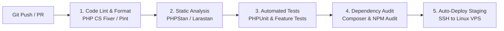

# CI/CD PIPELINE DOCUMENTATION
## JUMIANG SMART TOURISM & UMKM
**Continuous Integration & Continuous Deployment via GitHub Actions**

---

## 1. STRUKTUR PIPELINE GITHUB ACTIONS
Pipeline otomatis dieksekusi pada setiap `push` dan `pull_request` ke branch `main` dan `staging`:

---

## 2. ATURAN KELULUSAN PIPELINE (QUALITY GATE)
- Semua tahapan bersifat pemblokir (*blocking*). Jika satu unit test gagal, proses build digagalkan dan deploy dibatalkan secara otomatis.

---

## 3. KONFIGURASI WORKFLOW AKTIF
Pipeline diimplementasikan pada [.github/workflows/ci-cd.yml](../../.github/workflows/ci-cd.yml) dengan 4 job berurutan:
1. **`code-lint-and-validation`:** Validasi JSON/skema `composer.json`, `php -l` untuk seluruh berkas PHP, dan validasi sintaks `docker compose config --quiet`.
2. **`database-and-smoke-tests`:** Menjalankan container layanan `mysql:8.4`, mengimpor `database/jumiang_database.sql`, memverifikasi 22 tabel & jumlah data demo via PDO, lalu menguji 29 rute web preview (`public/index.php`) dengan HTTP 200 OK.
3. **`docker-and-security-audit`:** Memastikan `.env` tidak terlacak di Git, memindai pemanggilan fungsi debug berisiko, membangun image Docker `Dockerfile`, dan memverifikasi ekstensi PHP aktif.
4. **`deploy-staging` (Opsional):** Berjalan otomatis pada `push` ke branch `staging` apabila repository variable `ENABLE_STAGING_DEPLOY=true` dan secrets VPS (`VPS_HOST`, `VPS_USER`, `VPS_SSH_KEY`, `VPS_APP_PATH`) telah dikonfigurasi.
