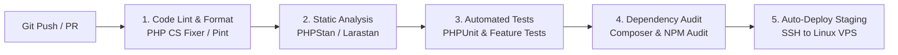

# CI/CD PIPELINE DOCUMENTATION
## JUMIANG SMART TOURISM & UMKM
**Continuous Integration & Continuous Deployment via GitHub Actions**

---

## 1. STRUKTUR PIPELINE GITHUB ACTIONS
Pipeline otomatis dieksekusi pada setiap `push` dan `pull_request` ke branch `main` dan `staging`:

---

## 2. ATURAN KELULUSAN PIPELINE (QUALITY GATE)
- Semua tahapan bersifat pemblokir (*blocking*). Jika satu unit test gagal, proses build digagalkan dan deploy dibatalkan secara otomatis.
