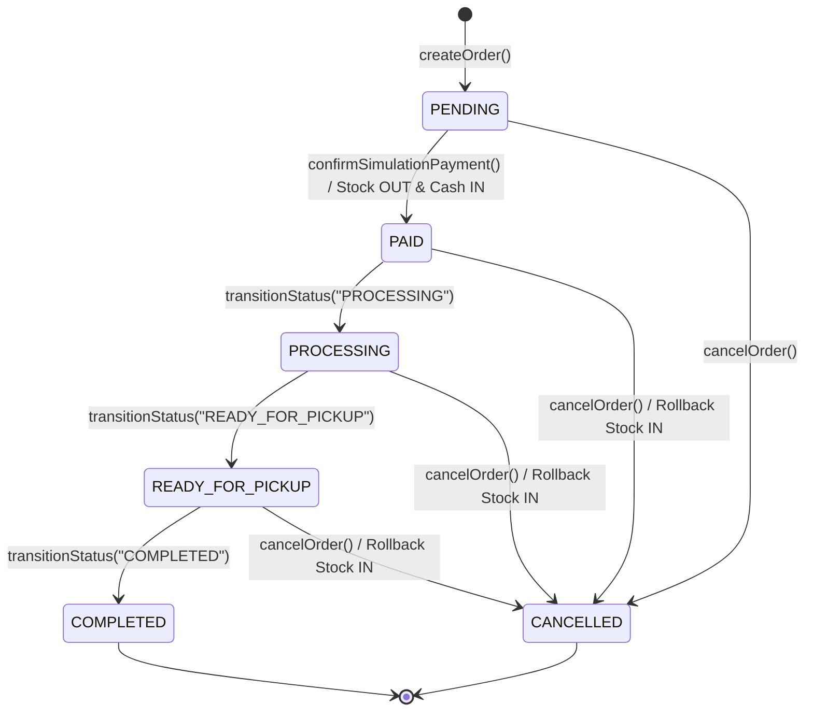

# DECISION TABLE & STATE TRANSITION TESTING REPORT
## JUMIANG SMART TOURISM & UMKM — PERTEMUAN MINGGU 04

Dokumen ini mendefinisikan Finite State Machine (FSM) dan Decision Table untuk **Status Pesanan (`MOD-MKT`)** dan **Verifikasi Mitra UMKM (`MOD-UMKM`)**, disertai hasil uji nyata pada `OrderStateTransitionUnitTest`.

---

## 1. State Transition Diagram — Order Lifecycle (`OrderProcessingService::VALID_TRANSITIONS`)

---

## 2. Decision Table: Transisi Status & Efek Samping (`MOD-MKT` + `MOD-INVN` + `MOD-FIN`)

| Rule | Current Status | Target Action | Stock Sufficient? | Allowed by FSM? | Resulting Status | Inventory Effect | Ledger Effect (`BUSINESS`) | Test Case Result |
|---|---|---|---|---|---|---|---|---|
| **R1** | `PENDING` | Pay Simulation (`PAID`) | Ya | Ya | `PAID` | `-qty` (`OUT`) | `+total_amount` (`INCOME`) | **PASS** |
| **R2** | `PENDING` | Pay Simulation (`PAID`) | Tidak | ditolak | tetap `PENDING` | 0 | 0 | **PASS** |
| **R3** | `PAID` | `PROCESSING` -> `READY_FOR_PICKUP` -> `COMPLETED` | N/A | Ya | `COMPLETED` | 0 | 0 | **PASS** |
| **R4** | `PAID` / `READY_FOR_PICKUP` | Cancel Order (`CANCELLED`) | N/A | Ya | `CANCELLED` | `+qty` (`IN` rollback) | Catatan audit | **PASS** |
| **R5** | `PENDING` | Jump ke `COMPLETED` | N/A | **Tidak** | Throw `InvalidArgumentException` | 0 | 0 | **PASS** |
| **R6** | `COMPLETED` | Cancel Order (`CANCELLED`) | N/A | **Tidak** | Throw `InvalidArgumentException` / `LogicException` | 0 | 0 | **PASS** |

---

## 3. State Transition — Verifikasi Mitra UMKM (`UmkmService::VALID_VERIFICATION_TRANSITIONS`)

- `PENDING -> VERIFIED | REJECTED`
- `REJECTED -> PENDING | VERIFIED`
- `VERIFIED -> SUSPENDED`
- `SUSPENDED -> VERIFIED`

**Verifikasi Nyata (`OrderStateTransitionUnitTest::test_umkm_verification_fsm_and_product_price_bva`):**
- Transisi sah `PENDING -> VERIFIED` berhasil (`PASS`).
- Transisi ilegal `VERIFIED -> PENDING` melempar `InvalidArgumentException` (`PASS`).
