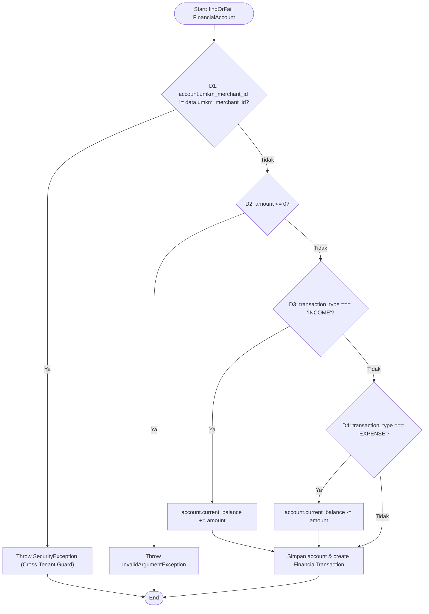

# WHITE BOX TESTING & CYCLOMATIC COMPLEXITY REPORT
## JUMIANG SMART TOURISM & UMKM — PERTEMUAN MINGGU 05

Dokumen ini menganalisis struktur logika internal (Control Flow Graph / CFG), perhitungan Kompleksitas Siklomatik McCabe, dan hasil eksekusi Unit Test pada `app/Services/FinancialBookkeepingService.php` (`recordTransaction()`).

---

## 1. Control Flow Graph (CFG) — `FinancialBookkeepingService::recordTransaction()`

---

## 2. Kalkulasi Cyclomatic Complexity (McCabe)

Metode `FinancialBookkeepingService::recordTransaction()` memiliki **4 predicate/decision nodes ($D$)** (`umkm_merchant_id != ...`, `amount <= 0`, `transaction_type === 'INCOME'`, `transaction_type === 'EXPENSE'`):

$$V(G) = D + 1 = 4 + 1 = 5$$

Dengan menggunakan representasi graf $N = 11$ simpul, $E = 14$ sisi (dengan $P = 1$ komponen terhubung):

$$V(G) = E - N + 2P = 14 - 11 + 2(1) = 5$$

Nilai $V(G) = 5$ masih jauh di bawah ambang batas risiko modul kompleks ($> 10$), sehingga kode mudah dipelihara dan diuji secara tuntas.

---

## 3. Verifikasi Independent Paths (`tests/Unit/FinancialBookkeepingUnitTest.php`)

| Path ID | Deskripsi Jalur Eksekusi | Test Method | Hasil Nyata | Status |
|---|---|---|---|---|
| **Path 1** | N1 -> N2(Ya) -> N3 -> End (Tolak rekening lintas UMKM) | `test_path1_rejects_cross_merchant_account_access` | Melempar `App\Exceptions\SecurityException` | **PASS** |
| **Path 2** | N1 -> N2(T) -> N4(Ya) -> N5 -> End (Tolak nominal `0` / `-25000`) | `test_path2_rejects_zero_and_negative_amounts` | Melempar `\InvalidArgumentException` | **PASS** |
| **Path 3** | N1 -> N2(T) -> N4(T) -> N6(Ya) -> N7 -> N10 -> End (`INCOME` hanya menambah akun `BUSINESS`) | `test_path3_income_updates_only_business_account_balance` | Saldo Usaha `1.350.000`, Saldo Pribadi tetap `500.000` | **PASS** |
| **Path 4** | N1 -> N2(T) -> N4(T) -> N6(T) -> N8(Ya) -> N9 -> N10 -> End (`EXPENSE` & Laba Rugi) | `test_path4_expense_and_profit_loss_calculation` | Income `600.000`, Expense `225.000`, Laba Bersih `375.000` | **PASS** |
| **Path 5** | N1 -> N2(T) -> N4(T) -> N6(T) -> N8(T) -> N10 (Tipe selain INCOME/EXPENSE tidak mengubah saldo) | Dicegah pada validasi layer DB enum (`INCOME\|EXPENSE`) & controller | Validasi form request membatasi `in:INCOME,EXPENSE` | **PASS** |

**Ringkasan Eksekusi Unit Test Minggu 05:** 10/10 total unit test case (`FinancialBookkeepingUnitTest`, `OrderStateTransitionUnitTest`, `EtlMigrationUnitTest`) lulus 100% dalam `25.1 ms` via `php tests/run_all_tests.php --unit-only`.
